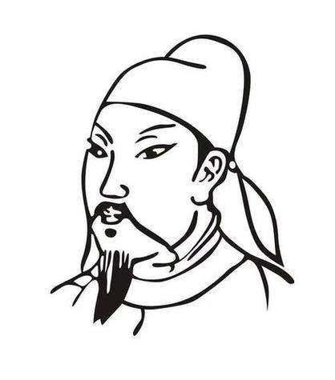
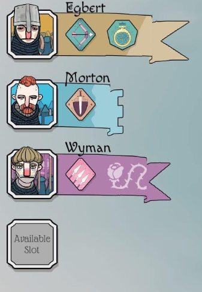
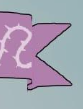

# UI美术规范

记录日期：2026-11-13。状态：已开始首轮实现，实际效果待试玩确认。

## 整体方向

以用户提供的《Bad North》暂停按钮和普通按钮截图为参考，保留其富于变化的外框、明显边线、底部阴影与存在感弱的配色。结合中国山区农村的背景，将机械均匀的轮廓线替换为有书写感的墨线。

界面应清楚、轻巧、克制，让外框和阴影建立形状，让墨线体现手绘特点。

## 外框与墨线

- 外框保持明确、简洁的基本形状，边缘和转角有适度变化；不同按钮可以有轮廓差异，不套用完全一致的标准矩形。
- 边线要清晰可辨，同时表现起笔、行笔、收笔：局部由轻到重，再自然收束，粗细变化顺着笔势发生。
- 局部允许飞白，以笔画内部少量露底、细小留白体现干笔质感，优先出现在较厚的笔段。
- 墨线变化应有组织。避免沿整圈均匀抖动、密集锯齿、随机毛刺，以及每处都出现的断线和飞白。
- 控制噪点密度，不靠满布颗粒、污渍或重度做旧来制造墨感。缩小到实际使用尺寸时，外轮廓仍应连贯、易读。

## 阴影与配色

- 保留可辨识的底部投影，使按钮与背景分离，形成轻微的悬起感；阴影贴近控件，轮廓简洁。
- 阴影的方向和深浅保持统一，避免厚重的立体倒角、强高光或过大的模糊光晕。
- 底色采用存在感较弱的低饱和浅色，可参考截图中的浅灰、米白和淡暖色。墨线与文字应提供足够的明暗区分。
- 色彩服务于识别和阅读，不用大面积鲜艳填色抢占场景注意力。具体色值待后续视觉稿确定。

## 两类参考控件

### 暂停按钮

保留两根独立竖条的明确识别特征。每根竖条各自具有略有变化的外轮廓、墨线边缘和底部阴影；两者协调，但不必机械地完全相同。墨线细节不得削弱暂停图标在小尺寸下的可读性。

### 普通按钮

参照横向展开的浅色按钮面、略有变化的边缘与切角、清楚的描边和底部阴影。文字与边框之间保留舒展的留白，墨线变化集中在外框的笔势和转折处。

## 按钮动效与字体试用

- 悬浮：按钮轻微上浮，底部阴影加深。首轮采用上浮约 2px、180ms 的柔和过渡。
- 点击：短促下压后回位。首轮采用约 1.5px 下压与轻微缩放，约 180ms 回位，避免明显弹跳。
- 移动端提供按压反馈，悬浮效果仅用于支持悬浮的指针设备。
- 试用楷体。首轮使用随项目打包的开源霞鹜文楷子集，并保留系统楷体作为后备；字体与许可记录见《UI资源记录》。
- 在系统要求减少动态效果时，保留交互和状态识别，关闭按钮位移与回弹。

## 小队 UI 与人物图标

本节于 2026-11-13 补充，已按以下方向开始首轮实现。

### 结构与轮廓

以用户提供的《Bad North》小队 UI 截图为形状参考，由两个相连的元素组成：左侧的人物头像框，以及向右延伸、承载小队技能信息的旗帜区域。保留人物框与横向旗帜之间清楚的层次关系。

头像框和旗帜的轮廓延续本规范的变化外框、清晰墨线、底部阴影与克制配色。墨线表现起收笔、粗细变化和少量局部飞白，控制噪点。

### 人物图像

- 代表人物以中国古代简笔人像为绘制方向，通过概括的脸型、眉眼、头饰和服饰建立人物特点，使用简练、有笔势的墨线配合克制的色块。
- 以用户补充的 `R.jpg` 进一步明确人物画法：脸部轮廓概括，眉眼、鼻部、嘴部用少量线条表达；线条流畅，转折和粗细有变化，人物神情明确。
- 试玩修正：进一步减少线条与细节，眉眼、鼻、嘴分别以少量粗笔概括；帽子不画密集编织，发须不画细丝，衣服只保留必要的大轮廓。墨线要能在实际头像尺寸下看出毛笔的提按、收锋与局部飞白。
- **最终人物头像必须上色。** 肤色、头饰和服装等区域以清楚、克制的彩色色块呈现，辅以少量明暗，保留墨线的识别力；参考图的黑白形式用于说明人物造型和线条画法。
- 头像应具有角色个性与表情，在较小的 UI 尺寸下仍可辨认；细节集中于脸部及关键身份特征。
- 允许头部、帽子或头巾适度突破头像框的上沿，使人像更有表现力。构图时保留足够的框外空间，避免被控件边界裁掉，也不遮挡相邻信息。
- 人像肩部与胸前衣服必须填实并延伸至画框内部下沿，由前层框沿压住；下半身按画框内缘裁切，头部保留上沿突破，避免人像悬在框内或衣服与底框之间留缝。
- 头像应对应游戏中的队伍身份。当前守村队可通过村民头饰、衣着及农具特征表达身份；工程师保留橙衣、白头巾和小锤等识别特征。具体人物长相与构图待后续绘制确定。
- 参考中的帽型、发须和衣领作为概括手法的参考；实际头像的头饰、发须与服饰按村民、工程师等角色身份设计。

### 旗帜区域

- 旗帜的底色、外形、末端剪裁和已有纹样，以场景中该小队实际持有的旗帜为依据，保证 UI 与实物对应。
- 当前守村队对应朱红棕色长条燕尾旗；工程师对应蓝色三齿旗，已有队伍标识为斜向白色小锤。此类队伍标识与后续技能图标分开考虑。
- 旗帜末端按补充的局部截图表现：较宽的主体旗面位于前层，末端折回后，旗尾处于后层并向右错开；下侧露出折返暗面，接缝有明确遮挡与层差。折叠属于整段旗尾的空间关系，不能只在旗尖添加小三角。旗尾依旧保留各队实际的燕尾或三齿剪裁。
- 旗面留出未来技能信息的位置。本阶段仅确定旗帜载体的造型与留白，技能布局、技能图标和技能交互均待后续开发。

### 与小队选中的关系

- 下方小队 UI 仅在玩家选中小队时显示，并呈现当前选中队伍的人像和旗帜。
- 未选中任何小队时隐藏；取消选中时同步隐藏；切换所选小队时更新为对应队伍的内容。
- 已调整原先常驻的小队卡片：选中时呈现对应队伍面板，取消或确认部署时收起；显隐采用轻微位移与淡入淡出。

## 后续制作检查

- 第一眼能清楚识别控件形状、图标与文字；进一步观察能看出墨线的起收笔、粗细和局部飞白。
- 手绘变化在实际 PC 和移动端尺寸下成立，不依赖放大查看，也不形成杂乱的视觉噪声。
- 边线、浅色按钮面和底部阴影共同建立层次，整体观感保持克制。
- 小队头像体现中国古代简笔人像的特点，头部突破画框时保持构图完整、信息清楚。
- 人物采用墨线勾勒与彩色填色结合的成稿形式，肤色、衣饰及队伍身份特征清楚可辨。
- 小队旗帜与场景中的实物对应，末端折叠可辨；下方小队 UI 的显示与实际选中状态一致。
- 当前字体、配色、交互状态和动效均为首轮试用效果，可在实际游玩后继续调整；技能区域仍待后续开发。

参考来源：用户提供的“屏幕截图 2026-11-12 145314.png”、“屏幕截图 2026-11-12 145320.png”、“屏幕截图 2026-11-12 145330.png”和 `R.jpg`。
