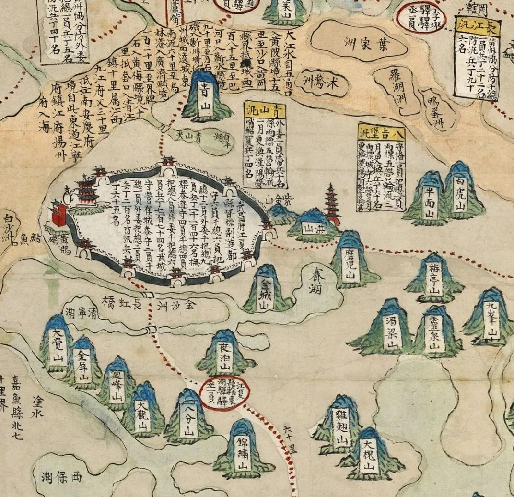
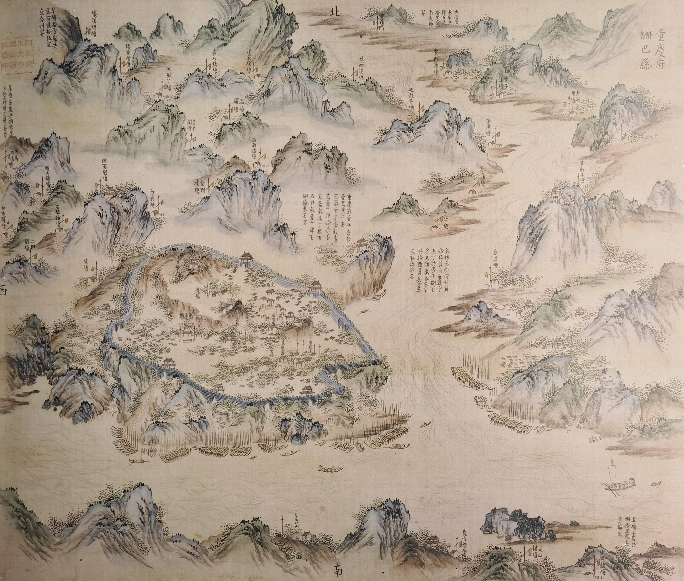
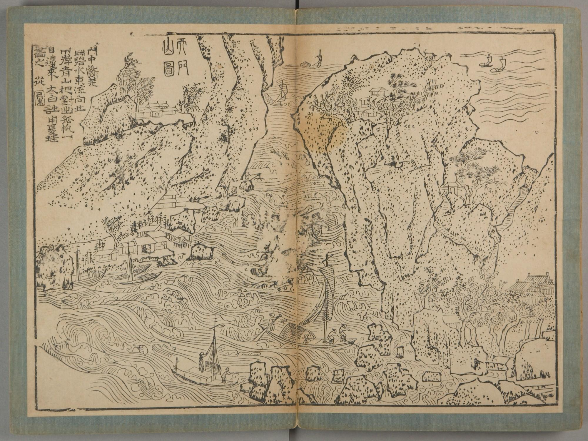
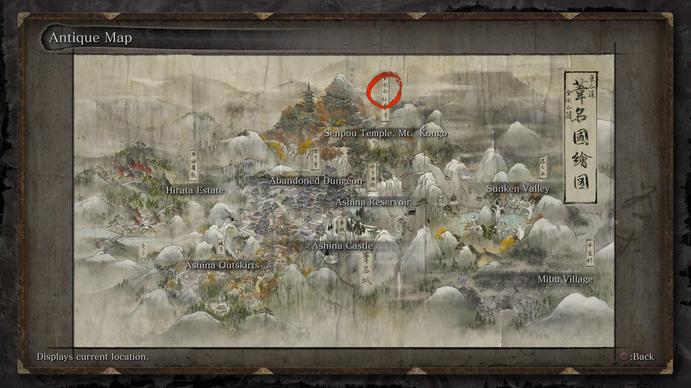
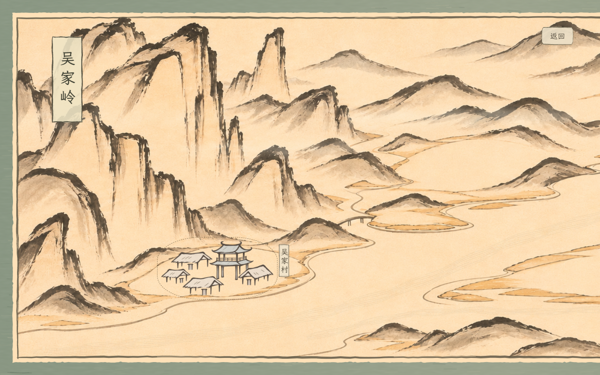
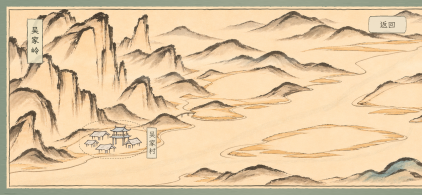
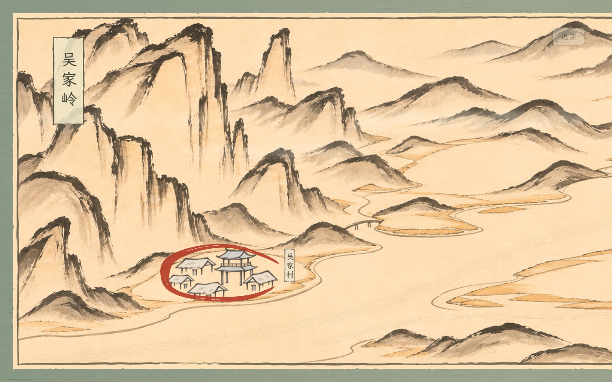

# 选关界面美术与交互规范

记录日期：2026-11-13。

状态：已完成首轮本地实现，接入吴家村一关。本文单独规定选关界面的视觉方向；通用按钮、墨线与字体继续参照 [UI美术规范](UI美术规范.md)。绘画素材与生成提示词见 [选关界面资源记录](选关界面资源记录.md)。

## 已确定的方向

- 采用毛笔绘制、造型简练而地理信息清楚的中国古代舆图，作为选关界面。
- 图 1 主要参考信息如何附着于地图；图 2 主要参考整体画面气质、山川组织与空间层次。
- 将画面组织成一幅连续的山川长卷，从左到右铺开，玩家可以横向移动浏览。PC 与移动端均以横屏游玩为前提。
- 文字信息密度明显低于两张参考图，只保留选关所需的名称与必要状态，维持简洁。
- 初版只启用吴家村一关；长卷预留五处关卡用地，位置与数量可随后续关卡规划调整，解锁与进度规则尚未确定。

## 初版补充与构图修正

- 首先让画面被理解为地图。每块关卡用地承载一组完整聚落，建筑实际范围约占该处空地宽度的六成，并随整幅画的浏览尺度同比缩放。吴家村按透明图片中的实际建筑范围裁去显示边距，避免把大量透明区域计入图标尺寸；同一空地不再留作第二个按钮。
- 高峭山峰、长条峭壁、低丘、城址台地和低平浅滩需要有不同的形态、浓淡与局部色相。避免将相同山峰均匀铺成图案。
- 宽水面以未着色纸面与少量水岸线形成留白，串联画面主次。青绿只在部分山体薄染，控制整片着色面积，保留古朴简洁的底色。
- 树木以点墨与几笔轮廓概括，桥梁用少量线条表示连接，不绘制繁密叶片、砌石和栏杆细节。
- 允许牺牲部分景物连续性，专门留出关卡用地。预留处保持干燥地表的岸线、山脚或浅滩边界，避免后续按钮悬在水上，也避免被山石、密林和彩色薄染占满。

## 两张参考图的取用方式

### 图 1：地图上的信息表达

参考其将山、河、城镇、道路与地名放在同一幅画面里的方式：山有形，聚落有屋舍，道路连接地点，文字依附于所指对象。玩家可以通过图像判断地点的性质与相互关系。

借鉴山体旁的简洁竖签、聚落附近的地名和沿地势行进的道路。标注应明确指向地点，并在相邻山势、河道之间安排空隙；当前不显示朱色编号或点记。

参考图中的长篇题注、里程记录、密集地名和大段框内文字不进入常驻界面。信息丰富主要由地理图像承担，文字保持精简。

### 图 2：整体绘画气质

以其连续的山势、水道、疏密与留白作为主要视觉依据。山峰之间有遮掩，河流在山间穿行，聚落与林木随地势分布；山水与地理信息共同构成长卷。

重点保留毛笔勾勒、简练皴线、淡墨晕染、成组点树和少量屋舍符号。通过浓淡、大小、前后遮挡与留白建立空间，让玩家浏览时感到山川在不断展开。

参考图的泛黄、污痕、折痕与历史文字属于原图状态，正式界面应控制这些细节，确保画面清爽、文字清晰。

## 长卷构图

以下为建议方案，待关卡规划明确后细化。

- 使用统一画幅与连续地理空间，山脉、河流和道路跨越浏览区域自然延续。
- 以主山势、河谷和行路方向串联画面，从左向右逐步展开；关卡地点随地势错落安排，上下位置有变化。
- 在聚落附近提高图像辨识度，在山间、水面与云气区域留出呼吸空间，形成疏密节奏。
- 相邻区域通过山势转折、河道流向和景物逐渐过渡，避免出现整齐拼块或重复山峰印章。
- 在画幅两端安排自然收束的山势、淡墨或留白。画面连同外侧布面装裱作为一个完整对象，横向拖动是在移动观看这幅画的视角，不能将外框固定在屏幕上。
- 主体为平面毛笔绘画，通过传统绘画层次表达地形。正式底图应为游戏重新组织与绘制，参考图作为设计依据保存。

## 绘画、颜色与文字

底色建议采用明净的暖米色纸底，辅以很轻的纸纤维感；墨色以深褐黑和灰墨为主，山林少量使用淡青绿、赭色。朱砂色用于少量关键标记，保持整卷克制。

山体用简明轮廓、少量皴线和薄染表现体积。当前底图采用 v5：明显减少碎皴、点树和重复细线，加粗主要山脊与崖壁笔触，保留高山、低丘、青绿山体之间的形态区别。村落采用 v3，保留原有四间草屋与一座楼阁的外形、位置与比例，仅简化屋面细节并加重屋檐、立柱和门洞笔触。林木、屋舍、桥与渡口保持经济的简笔表达。

墨线延续已确定的起收笔、粗细变化与局部飞白，变化顺着笔势组织；纸纹和墨迹不得盖过地点与文字。

地图上的短地名可采用竖排小签或顺景物落位的题字，关键信息与操作文字保持易读的楷体。所有需要准确阅读的文字应独立排版，便于后续调整字号、名称与状态。山体皴线、道路和文字之间保留明确的视觉区分。

## 关卡地点与信息层级

建议让可选关卡落在画中的聚落或地标上，用屋舍、村口、桥头等与关卡内容对应的图像承载。具体地标类型随关卡设计确定。

信息分为三个层次：

1. **浏览时常驻：** 关卡地点、简短名称，以及确有必要的通关或可进入状态。装饰性山川通常不加文字。
2. **点击后确认：** 初版直接在村落周围绘制不闭合墨圈，绘制完成后接入云雾转场进入关卡。额外信息签与关卡说明待后续确有需要时再设计。
3. **环境信息：** 山、水、林、屋舍与弯曲道路负责呈现地理关系和氛围，降低玩家对文字说明的依赖。

道路随地形弯曲，过河位置用桥或渡口表达。关卡连接关系依据后续进度设计绘制；目前不预设单线闯关、分支或解锁方式。

地图上可见的关卡与环境聚落应有清楚区分。建议以短地名签和克制的印记共同提示交互；选中地点用小印章或墨圈等形式强调，保留地景本身的识别度。状态同时通过形状或笔墨变化表达，避免只依赖颜色。

常驻界面仅保留浏览、返回与选关必需的信息。波次数、难度、奖励、星级、资源数量等是否出现，待对应玩法确定后再决定。

## 浏览与操作建议

- PC 支持按住拖动画卷，移动端支持单指横向拖动；画纸、布面外框、画内题注和动态景物一起平移，保留短促、克制的惯性。整幅装裱按覆盖视口的尺度显示，拖到两端也不露出外侧背景。
- 点击或轻触村落后执行墨圈确认，绘制结束并短暂停留后进入云雾转场。通过拖动与点击的区分来避免浏览时误入关卡。
- 区分拖动与点击：发生明显拖动后，松手只结束浏览，不触发地点选择。
- 地点热区覆盖完整建筑组，兼顾移动端操作；地名只作注释，不纳入点击热区，相邻地点保持足够距离。
- 保留一部分邻近地景在画面边缘，横向拖动继续展开画面；当前不加额外操作提示文字。
- 返回选关时建议恢复原先浏览位置和选中地点。键盘访问方式、缩放需求与首次进入时的定位策略，待交互设计进一步确定。

## 动效与流程衔接建议

画面以安静的长卷为基调。主要运动来自玩家拖动；选中反馈采用轻微墨色加深、印记浮现或短促淡入，地名与关卡标记保持稳定。环境动态若加入，应少量、缓慢，服务于山川氛围。

返回按钮、信息签与进入按钮延续通用墨线外框、克制配色、楷体和按钮反馈。地图本身的绘画语汇由本文独立约束。

初版流程为“开始界面 → 选关画卷 → 吴家村守村战”。开始界面进入选关、选关返回开始界面、墨圈完成后进入战斗，均使用现有云雾转场；选关期间波次与战斗不计时。战斗内的“重新开始”仍直接重开当前关卡，“回到开始界面”仍返回旋转山村开始界面。

## 初版村落按钮与墨圈

- 一组简笔楼阁与草屋共同组成关卡按钮，和舆图的笔墨、配色相融。移除朱砂编号；当前在已认可的建筑轮廓上加重主要灰褐墨线、减少内部碎线，以极淡赭色和灰青薄染上色。
- 村落旁竖排“吴家村”，字号缩为约 14—18px，底层增加窄长纸签和有粗细变化、略不规则的毛笔矩形框。
- 地名纸签独立于村落按钮，只作为画轴信息存在：不参与悬停上浮、阴影、按压与选中动效，也不作为点击入口。它随画轴浏览一起移动。
- 鼠标悬停时，仅村落建筑轻微上浮约 3px，并出现较弱的阴影；按下后短促回压。
- 选关圈参考新增《只狼》地图截图，使用朱红色、不闭合的毛笔圈，围绕村落建筑绘出，避开地名纸签。线宽随运笔压力变化，具有细起笔、较重笔腹、渐细收笔与少量局部飞白；本轮笔腹加粗约六成，绘制缩短为约 0.52 秒，完成后停留约 0.12 秒，再启动云雾。
- 绘圈过程中锁定再次选择、拖动和返回，保证只进入一次关卡。减少动态效果模式缩短绘圈时间，并停用浏览惯性与悬浮位移。

## 装裱画框与地图名称

- 外边框参考古籍舆图照片，采用低饱和灰青绿布面、疏淡擦痕和细小不规则的纸布接缝，控制磨损幅度，避免规整格纹与夸张锯齿。墨边以填充笔迹轮廓表现粗细与运笔压力，局部飞白从笔迹内部扣出，不用粗细两条平行描线模拟毛笔。
- 黑色墨线是绘画边界：图像沿墨线的同一条手绘轮廓裁切，由墨迹压住交接处；墨线外保留约 10—13 个画内单位的窄纸边，再向外连接绿色装裱。图像不能穿过墨线一直延伸到绿色接缝。左侧不为题注预留独立空白栏；纸布接缝另有不规则裁切，不能混淆这两层边界。
- “吴家岭”采用《只狼》截图右上方的竖排题签形式：浅纸色矩形、手绘墨框和较大的竖排文字，直接覆盖在左侧山水画面上。它属于整幅画，随画纸、外框一起移动，可以被移出视野。
- 只有“返回”按钮固定在屏幕右上方的黑色墨线内侧，按钮外框与底部阴影也应位于墨线内。位置随横屏尺寸计算，并以画轴最右端的边界留足间距；画轴内的地名、题注和选中圈都属于画中坐标。
- 按整幅装裱的比例覆盖横屏视口，不在外侧保留空白边距。边界约束以包含布面外框的完整尺寸计算；画幅超宽时依然覆盖视口，手机横屏与矮屏保留可点选的村落尺寸。

以下《只狼》截图继续用于纸签和朱红选中圈参考，外边框以最新古籍舆图参考为准。

## 画中环境动效

- 河水按底图的真实岸线单独规划主河道、洲北水道与绕洲南侧的支流。成组细墨笔触沿各条曲线的局部流向缓慢推进。除中央洲地外，按 v5 底图浅滩赭色区域提取保守的陆地轮廓并向岸线外缓冲，以这些轮廓的并集扣除水纹；不能仅靠中心线避让，或用重叠的奇偶裁切把陆地重新开出孔洞。流迹保持低透明度，保留纸面水域的留白。流路在 `src/map-water.js`，浅滩轮廓在 `src/map-shallows.js`；更换底图时需要重新检查这两者。
- 山间薄雾采用接近纸色的柔和亮雾，增强山体上的可辨识度并扩大覆盖厚度，仍能透出皴线。缓慢横漂，随约 29—38 秒的错开周期渐显渐隐，避免同时闪动或遮住地名。
- 不定时从可视画面两侧的不同高度飞入小群墨色飞鸟，飞往出生时可视区域的中段。单只翼展约 13—19 个画内单位，随整画同比缩放；单次飞行约 19—26 秒，后段用至少 11 秒逐渐淡出，保持轻缓。
- 水纹、薄雾与飞鸟都绘制在画轴内部的同一坐标空间。鸟群在生成时记录画轴中的起点和目标，后续拖动画轴不改变已生成鸟群的飞行目标，避免它们贴着镜头移动。
- 环境时钟仅在选关界面激活时推进，绘制限为每秒最多 30 帧；减少动态效果模式关闭三类环境动画。

## 预留关卡用地

位置采用相对整幅底图的百分比，代码记录在 `src/level-map.js` 的 `levelMapSites`。以实际画出的空地为落位依据：

- 吴家村：约 `(19.5%, 73%)`，左侧高山下的河岸空地；当前唯一启用的入口。
- 山口预留处：约 `(44%, 42%)`，中部低丘围合的平缓台地。
- 河洲预留处：约 `(56%, 73%)`，宽河面中的平坦洲地。
- 城址预留处：约 `(76%, 48%)`，右岸山脚较高的空台地。
- 山麓预留处：约 `(91%, 73%)`，右侧青绿山体下的河岸空地。

后四处只保留地理空间与坐标，不显示数字、村落按钮或锁定提示；后续可接入不同村镇或关隘图标。它们不代表已经确定总关卡数或解锁顺序。

## 后续需要确定

- 关卡数量、地点名称、地形主题及各地点的关联关系。
- 进度保存、通关标记、解锁与重玩规则。
- 选中信息签的必要字段与具体位置。
- 长卷的最终长度、各横屏尺寸下的浏览尺度，以及是否需要缩放。
- 正式底图的绘制方式与局部资产组织；优先保证长卷连续、地点清晰和文字可读，再确定技术方案。

后续视觉稿重点检查：是否一眼可辨为中国古代山川舆图；是否能在低文字密度下识别可选地点；横向浏览是否具有连续长卷的感觉；手机横屏下是否仍然清楚、易点。

## 初版预览

